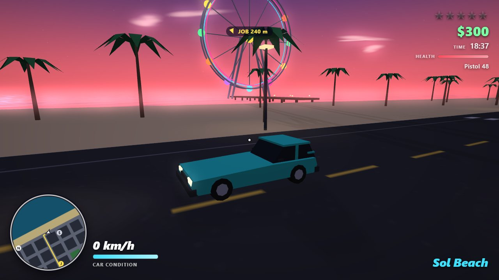
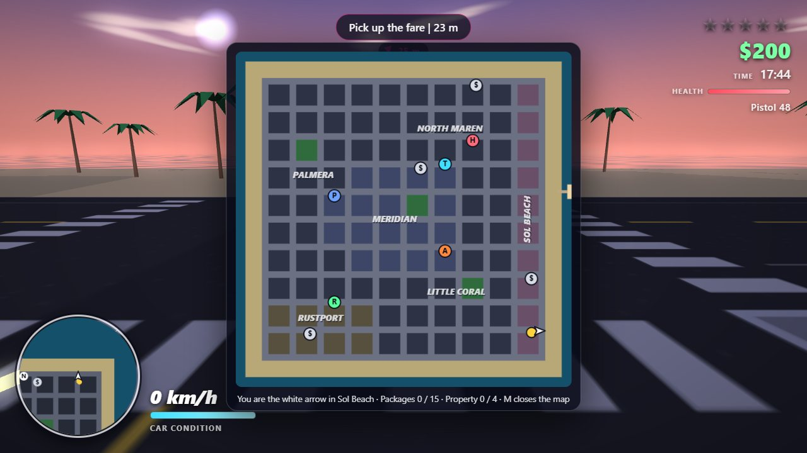

# Neon Coast

[Play in your browser](https://juw12.github.io/neon-coast/) · [Download the offline build](https://github.com/juw12/neon-coast/raw/refs/heads/main/NeonCoast.html)

| | | |
|---|---|---|
|  |  |  |
|  |  | Screenshots are taken from the running game by `test/smoke.py` and `test/city_shots.py`. |

An original single-player 3D island sandbox in one HTML file: steal cars, run jobs, drive a cab, buy
property, outrun the police. Not a Rockstar product or mod; no Grand Theft Auto installation or assets needed.

Open NeonCoast.html in Chrome or Edge on a desktop with WebGL. No server, network, installer or account
needed. Choose New Game or Continue. Walk up to a car and press F. Drive with WASD; Space is the handbrake.
Follow the arrows on the road to the yellow J marker for the first of six jobs. Press M for the whole map
and P to pause. Progress is stored in your browser, so use the same browser and file location to resume.

## Version 1.2 · City Lights

- **Cab fares.** Take any yellow City Cab and press **T**. A passenger waves from the kerb: stop in the ring
  to pick up, stop in the next ring to drop off before the clock runs out. Pay is $60 plus $0.38 a metre, a
  tip for spare seconds (at most half the fare) and 10% more for each fare in a row, up to 50%.
- **Property.** Four places carry a **$** on the map. Walk into the ring and press **E** to buy ($2,000 to
  $14,000). Each pays rent by the game hour, holds up to six hours of it, and patches you up when you walk
  back in.
- **Police helicopter.** At four stars a helicopter flies in with a searchlight and keeps you in sight from
  above, so a side street no longer hides you. At five stars its gunner fires. A respray still clears it.
- **Finding the way.** Arrows on the road in your lane and a line on the minimap lead to the current
  target. **M** opens a map of the whole island with every place, your properties and the route.
- **Perks.** 5 hidden packages: 25% less damage. 10 packages: respray at half price. 10 cab fares: double
  tips. All six story jobs: 50% more rent. The pause screen shows your progress on each.
- **Odd jobs in four kinds** after the story: Rush Order, Repo Run, Block Dash and Hot Parcel.
- A brighter night: lit windows, shop fronts, neon and lamps glow on Pretty graphics.

Saves from versions 1.0 and 1.1 load as they are.

## Harbor courier shift

Choose **Harbor courier shift** at the title screen for the Hauler van, or press
**G** between story jobs using any vehicle. Stop in the numbered amber rings:
film cans at Reel Lab, a projector lamp at Electric Works, then Pier 03.
The departure clock starts once you have wheels. Earn $450 plus a time bonus;
your quickest successful run is saved separately from the six story jobs.
Pause to cancel the shift.

## Tune-up shop and landmarks

The cyan **T** on the map is the Tune-up shop. Stop your car in the ring to buy the next of three stages
($1,500, $3,000, $6,000). Each stage adds 14% acceleration and 7% top speed to the car you drive and is kept
in the save. Driving through without stopping buys nothing.

Things to steer by: the Sol Wheel (a turning Ferris wheel on a pier off Sol Beach, looks only), the Meridian
Spire on the tallest tower, red-light masts on the other towers, smokestacks over Rustport, and pitched roofs
on the low suburb houses.

## Tests

Needs Python with Playwright and Chrome. Run from this folder after `python build.py`:

- `python test/gates.py` - ten pass/fail gates (offline single file, clean console, the core loop with 22
  checks, all six jobs pay, arrest, mouse look, frame rate, HUD overlap at three sizes, own names, clear first view).
- `python test/harbor.py` - the harbor courier shift from start to payout, cancel and timeout.
- `python test/city.py` - 19 checks on cab fares, property, perks, the helicopter, the route, the map and
  saves from older versions.
- `python test/drive.py 5` - plays the first story job five times with key presses only (W A S D and F;
  nothing is moved by script) and reports how many runs finished. Last run on the build machine: 5 of 5 finished, in 80.5 to 108.5 seconds, with no wanted stars. Traffic is random, so results vary.

- `python test/fps_ab.py NeonCoast.html other-build.html` - frame rate of two builds measured in turn, for
  when the PC is busy and the frame-rate gate reads low.

Apart from that one driven job, jobs are passed by script (the car is moved between markers), so the tests
do not measure how hard they are for a person. Tested in Chrome on one Windows laptop; no phone or gamepad
controls. No real players have tried it yet; the scores in `hone/refine_log.md` come from AI judges reading
a fact sheet and screenshots. `hone/rubric.md` holds the scoring rubric.

## Edit and rebuild

Edit the JavaScript modules or the HTML template in src/, then run
`python build.py` from this folder. Three.js r149 is vendored so the rebuild
works offline. See LICENSE for redistribution terms.
