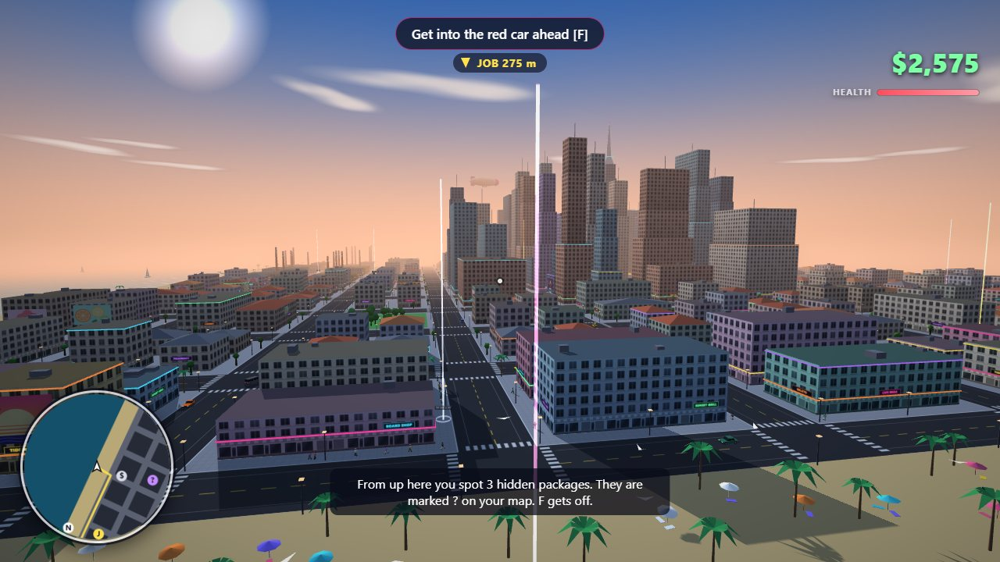
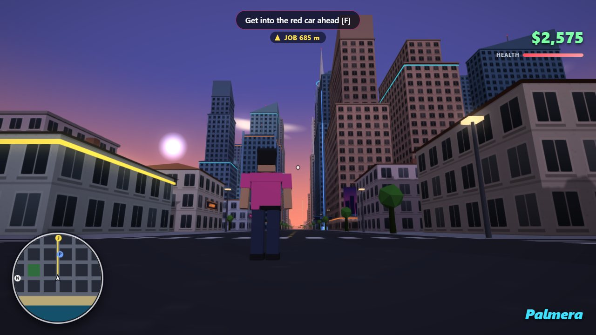
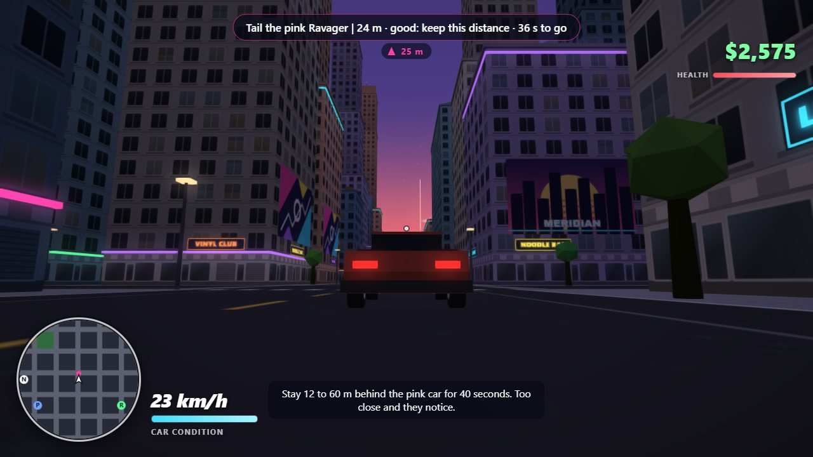
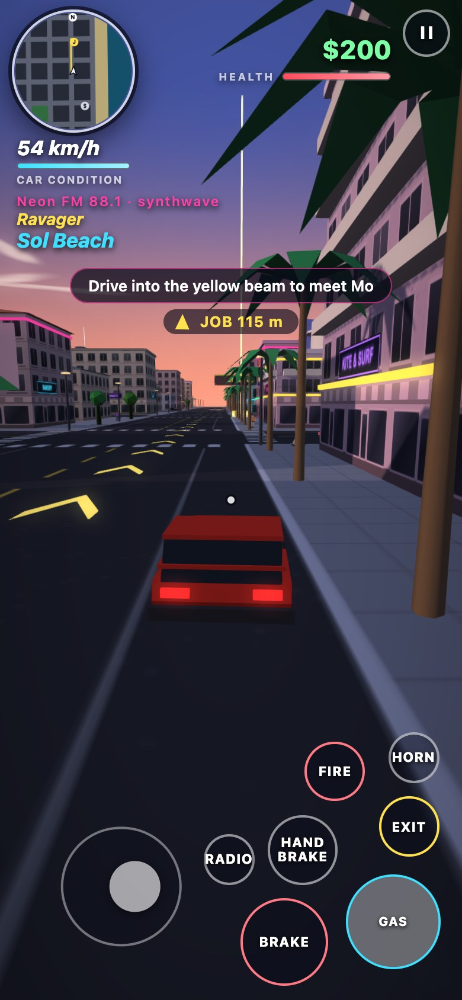

# Neon Coast

[Play in your browser](https://juw12.github.io/neon-coast/) · [Download the offline build](https://github.com/juw12/neon-coast/raw/refs/heads/main/NeonCoast.html)

| | | |
|---|---|---|
|  |  |  |
|  |  |  |
|  |  |  |
|  |  | Screenshots are taken from the running game by `test/smoke.py` and `test/city_shots.py`. |

An original single-player 3D island sandbox in one HTML file: steal cars, run jobs, drive a cab, buy
property, outrun the police. Not a Rockstar product or mod; no Grand Theft Auto installation or assets needed.

On a phone or tablet, open the [play link](https://juw12.github.io/neon-coast/) in Safari or Chrome: the
game switches to touch controls by itself, landscape or upright (see [On a phone](#on-a-phone-or-tablet)).

On a desktop, open NeonCoast.html in Chrome or Edge with WebGL. No server, network, installer or account
needed. Choose New Game or Continue. Walk up to a car and press F. Drive with WASD; Space is the handbrake.
Follow the arrows on the road to the yellow J marker for the first of six jobs. Press M for the whole map
and P to pause. Progress is stored in your browser, so use the same browser and file location to resume.

## Version 1.7 · Tail Lights

- **A sixth odd job that is not a race.** Shadow Run: Rico wants a car followed. Stay 12 to 60 m behind
  the pink car for 40 seconds. Closer than that for three seconds and the driver spots you; further for
  eight and you have lost them. For the first twenty seconds a gap does not count: catch up. No clock,
  no marker to reach. It pays $700.
- **The first job starts where you stand.** The yellow beam is now in the red car's own lane, 40 m ahead
  of the start spot: get in, roll forward, the job begins. The whole first job is about 270 m instead of 470.
- **Paper Round says it is on foot.** The beam is labelled ON FOOT, and the round does not start from a
  driver's seat: a line tells you to leave the car first, before the clock runs.
- **A head start in Borrowed Time.** Taking the marked car gives ten seconds before the two stars arrive
  (eight seconds and one star in the Repo Run odd job).
- **A marked way out of the heat.** In Heat Wave and Hot Parcel the road arrows lead to Mo's Respray while
  you are wanted. Losing the police out of their sight still works as before.
- **A working dock.** The shore in front of the Rustport quay is a concrete apron with a truck lane, a
  crane rail and a hazard edge; the quay has mooring bollards, floodlight masts and yard tractors. Both
  maps show it.
- **See-through buttons on a phone.** The touch buttons are fainter, so the road shows behind them.
- **All six story jobs are now played by key presses in the tests**, and so is Shadow Run. The Tests
  section below says how often the script finished each one: the two police jobs are still the hard ones.

Saves from 1.6 carry over.

## Version 1.6 · Sharp

- **A picture as sharp as the screen.** Graphics has a third choice, **Auto**, and a phone starts on it.
  1.5 started phones on Fast: 1.5 drawn pixels per point, no glow, no shadows. Auto starts at 2 pixels per
  point with the neon glow and adds shadows when the frame rate allows.
- **It measures while you play.** Below 40 frames a second it gives up shadows first, then the glow and
  half the crowd, and drawn pixels last, never under 1.5 per point on a touch screen. A step that buys no
  frame rate is given back. Above 55 for a while it climbs again. Fast and Pretty stay fixed choices.
- **Shots find their target.** On a touch screen each shot first turns the view onto the nearest target
  close to the crosshair (police first when you are wanted). Sliding the thumb on FIRE still aims by hand.
- **Arrows to steer.** Settings, Steering: Stick or Arrows. Arrows puts two buttons under the left thumb
  while you drive; on foot the stick stays.
- **CAR lights up** when a car is close enough to take, and buttons tick under the thumb on Android.
- A phone that played 1.5 is moved from Fast to Auto once; what you pick after that is kept.

## Version 1.5 · Pocket

- **Touch controls.** A thumb stick on the left walks and steers; GAS, BRAKE, HAND BRAKE and the rest sit
  under the right thumb. Drag anywhere else to look around. The buttons change with what you are doing:
  on foot, in a car, on the Sol Wheel.
- **Landscape or upright.** The screen rearranges itself for both. Landscape shows more road; upright
  widens the lens so the street still fits.
- **An icon on the home screen.** From the web address the game can be installed: it then opens full
  screen and plays with no network.
- **A sky on Safari.** On Fast graphics Safari drew the sky black. Fixed.
- Keyboard and mouse play exactly as before, and NeonCoast.html is still one file that runs on its own.

## On a phone or tablet

Open <https://juw12.github.io/neon-coast/> in Safari (iPhone, iPad) or Chrome (Android).

| On its side | Upright |
|---|---|
|  |  |

| Control | What it does |
|---|---|
| Left thumb, lower left | A stick appears under it. Walk, or steer the car. Push it right out to sprint. Settings can give the car two arrows instead |
| Drag the view | Look and aim |
| CAR / EXIT | In or out of any car |
| GAS, BRAKE, HAND BRAKE | Drive. BRAKE at a standstill reverses |
| FIRE / PUNCH, SWAP | Shoot or punch. Shots find a target near the crosshair; slide the thumb on FIRE to aim yourself. SWAP changes pistol and fists |
| JUMP, HORN, RADIO | As named |
| USE, CAB | Appear when they apply: in a property or Sol Wheel ring, in a City Cab |
| The round map | Tap for the whole island, tap again to close |
| II | Pause. The pause screen also starts the harbor courier shift and picks another odd job |

**Install it.** iPhone or iPad: Share, then *Add to Home Screen*. Android: browser menu, then *Install app*
or *Add to Home screen*. The icon opens the game full screen, and after that first visit it plays offline.
On an iPhone this is the only way to get rid of Safari's bars; on Android the game also goes full screen
by itself when you start.

**Good to know.** A phone starts on Auto graphics (see 1.6); Fast and Pretty are fixed choices in the
settings. On an
iPhone the ring/silent switch also silences the game. Progress is stored per browser, so Safari and the
home-screen icon each keep their own save. A laptop with a touch screen switches to touch controls at the
first finger; adding `?touch=1` to the address shows the phone layout with a mouse, `?touch=0` keeps
it off.

The phone files are `manifest.webmanifest`, `sw.js` and `icons/` (drawn by `tools/make_icons.py`). They
are only asked for on a web address; the single HTML file opened from disk asks for nothing.

## Version 1.4 · Skyline

- **Buildings with outlines.** No more plain boxes: roof lips everywhere, slanted and stepped crowns, corner
  fins and water tanks on the Meridian towers, balcony bands and round penthouses on the Sol Beach hotels,
  saw-tooth roofs and yards in Rustport, chimneys in the suburbs. Beyond the Rustport waterline there is a
  quay with container stacks, three gantry cranes and a freighter.
- **Smoother edges.** A second anti-aliasing pass on Pretty graphics.
- **A learner phase.** Until your first job is done, crimes bring no stars, so the first minute cannot end
  in an arrest. After it the police watch you as before.
- **A fifth odd job, on foot.** Paper Round: four envelopes round one block against the clock for $550.
  After the story, **J** asks the contacts for another kind of odd job.
- **Three radio stations in three styles.** Neon FM (synthwave), Coast 98 (beach pop) and Low Tide (late
  night) now differ in drums, bass and tune, not only in speed. **R** in a car turns the dial.
- **More of the game played by key presses in the tests.** `test/drive.py` now plays three story jobs.

Saves from versions 1.0 to 1.3 load as they are.

## Version 1.3 · Clear Day

- **A first job inside a minute.** Get in the red car, drive to the job beam, follow the beach road to the
  Sol Wheel pier. It used to end at the respray shop on the far side of town. Until that job is done your
  car smokes when battered but cannot be wrecked.
- **Ride the Sol Wheel.** Walk to the foot of the pier and press **E** ($25). The camera goes once round the
  wheel over the beach and the city; the ride patches you up and marks the three nearest hidden packages
  with a **?** on the map. **F** gets off early.
- **A city with a daytime look.** 86 painted walls in eight designs, two per district. Parasols and towels
  on the sand, sailing boats, gulls, and the Coastliner airship lapping the island. Teal sea, warm horizon,
  walls shaded from foot to top, new colours for the Meridian towers and the Rustport sheds.
- **Police heat reaches everything.** With stars on you no cab passenger gets in, the Tune-up shop is shut
  and the wheel sells no ticket. Walking into a property you own loses the police at one or two stars.
- **Perks you can see coming.** Each package, fare or job shows a card with the distance to the next perk
  ("Body armour 4 / 5"), and an unlock is announced with what it gives.
- **A quieter screen.** The HUD is cash and health. Stars show only when you are wanted, the weapon line for
  five seconds after it changes, and the clock moved to the map and pause screens. The pause screen is three
  buttons, settings and perks; the map legend sits on the map (**M**). The title screen shows six keys.

## Version 1.2 · City Lights

- **Cab fares.** Take any yellow City Cab and press **T**. A passenger waves from the kerb: stop in the ring
  to pick up, stop in the next ring to drop off before the clock runs out. Pay is $60 plus $0.38 a metre, a
  tip for spare seconds (at most half the fare) and 10% more for each fare in a row, up to 50%.
- **Property.** Four places carry a **$** on the map. Walk into the ring and press **E** to buy ($2,000 to
  $14,000). Each pays rent by the game hour, holds up to six hours of it, and patches you up when you walk
  back in.
- **Police helicopter.** At four stars a helicopter flies in with a searchlight and keeps you in sight from
  above, so a side street no longer hides you. At five stars its gunner fires. A respray still clears it.
- **Finding the way.** Arrows on the road in your lane and a line on the minimap lead to the current
  target. **M** opens a map of the whole island with every place, your properties and the route.
- **Perks.** 5 hidden packages: 25% less damage. 10 packages: respray at half price. 10 cab fares: double
  tips. All six story jobs: 50% more rent. The pause screen shows your progress on each.
- **Odd jobs in four kinds** after the story: Rush Order, Repo Run, Block Dash and Hot Parcel (five since 1.4).
- A brighter night: lit windows, shop fronts, neon and lamps glow on Pretty graphics.

## Harbor courier shift

Choose **Harbor courier shift** at the title screen for the Hauler van, or press
**G** between story jobs using any vehicle. Stop in the numbered amber rings:
film cans at Reel Lab, a projector lamp at Electric Works, then Pier 03.
The departure clock starts once you have wheels. Earn $450 plus a time bonus;
your quickest successful run is saved separately from the six story jobs.
Pause to cancel the shift.

## Tune-up shop and landmarks

The cyan **T** on the map is the Tune-up shop. Stop your car in the ring to buy the next of three stages
($1,500, $3,000, $6,000). Each stage adds 14% acceleration and 7% top speed to the car you drive and is kept
in the save. Driving through without stopping buys nothing.

Things to steer by: the Sol Wheel (a turning Ferris wheel on a pier off Sol Beach), the Coastliner airship, the Meridian
Spire on the tallest tower, red-light masts on the other towers, smokestacks over Rustport and the gantry
cranes on its quay, and pitched roofs on the low suburb houses.

## Tests

Needs Python with Playwright and Chrome. Run from this folder after `python build.py`:

- `python test/gates.py` - ten pass/fail gates (offline single file, clean console, the core loop with 22
  checks, all six jobs pay, arrest, mouse look, frame rate, HUD overlap at three sizes, own names, clear first view).
- `python test/harbor.py` - the harbor courier shift from start to payout, cancel and timeout.
- `python test/city.py` - 54 checks on cab fares, property, perks, the helicopter, the route, the map,
  saves from older versions, the Sol Wheel ride, what the police stars switch off, the learner phase, the
  **J** key, the Paper Round and its ON FOOT start rule, the building outlines, the near first beam,
  Shadow Run (seen, lost, a slow start, passed), the head start and the respray route. The Shadow Run and
  head-start checks wait on the game's own clock. Other checks still wait a fixed time, so on a busy PC a
  timer check can fail: on 1.7 it read 52, 52 and 54 of 54 in three runs in a row (a cab fare paid late,
  the helicopter not yet gone), and before the two checks used the game clock 52, 51, 51 and 49.
- `python test/radio.py` - 14 checks that record the three radio stations at the game's master output and
  measure them: loud enough, no clipping, the beat repeating at each station's own tempo, different tone.
  It cannot tell whether the music is pleasant.
- `python test/drive.py 5` - plays the first story job five times with key presses only (W A S D, F, J and
  Space; nothing is moved by script) and reports how many runs finished. `python test/drive.py 3 2` plays
  job 2 three times; jobs 3 to 6 and `tail` (Shadow Run) are asked for the same way. For every job but the
  first the save file is first set to "earlier jobs done". On foot the script walks along the pavements to
  the nearest parked car. A try that fails is tried again inside the run's time limit, and the result lists
  the tries, the arrests and the reason the game gave. Traffic is random, so results vary.

  Tail Lights before it was merged with 1.6 Sharp (the driving, police, job and keyboard code is the same
  in 1.7: Sharp changed the graphics settings, the touch aim and steering and one save default), one run
  at a time:

  | job | finished | time | what went wrong |
  |---|---|---|---|
  | 1 First Wheels | 3 of 3 | 29.7 to 47.9 s (1.4: 38.5 to 50.9 s) | |
  | 2 Hot Delivery | 2 of 2 | 146.8 and 222.1 s | |
  | 3 Midnight Sprint | 1 of 2 | 279.7 s, second try | other tries ran out of the race clock (measured with a second test running) |
  | 4 Borrowed Time | 1 of 2 | 204.9 s, first try | the other run: stolen car wrecked by police cars, twice |
  | 5 Heat Wave | 0 of 3 | - | arrested or taken out 8 times in 8 tries, up to five stars |
  | 6 Coastline Run | 1 of 1 | 211.2 s, first try | |
  | Shadow Run | 3 of 3 | 109.5 to 205.8 s | first try once, second try twice (spotted once, lost them once) |

  The same script is much worse when the PC is busy. Earlier the same day, with two or three browsers
  running at once and the frame rate down to 18 to 50 a second, job 2 finished 1 of 4 runs, job 5 0 of 4
  and job 6 0 of 2; job 4 finished 0 of 8 (four of those with other browsers running, four before the
  script learnt to walk along the pavements, when it could get stuck in an alley after an arrest). Two more
  runs of job 3 did not finish and their result file was lost. Releases 1.5 and 1.4 were tried in the same
  hour: 1.5 finished job 4 0 of 2 and job 2 0 of 1, 1.4 finished job 2 1 of 1. So run this test alone.

  On the merged 1.7 build, on the same busy PC in the evening: job 1 finished 3 of 3 (56.4, 80.8 and
  187.0 s; the game runs slower than the clock when the frame rate drops under 20 a second) and Shadow Run
  2 of 3 (199.0 s on the first try, 211.5 s on the second; in the third run the player was taken out on the
  way to the job beam and did not reach it in 421 s). Jobs 2 to 6 were not played again on 1.7.

  What it shows about the game: the two police jobs are the hard ones. At two stars a police car with a clear
  view drives straight at the player at top speed, one head-on hit takes most of the Vanta GT's health, and
  every such hit also counts as a crime, so the stars climb. The 10 s head start in 1.7 did not change that.
  It is the first thing to tune next.

- `python test/touch.py` - touch play in Chrome emulating a phone at four screen sizes, landscape and
  upright, with real touch events (two fingers where two thumbs are needed): every button, the stick, the
  look drag, the map, pause, the Sol Wheel; nothing overlapping or off screen; every hint naming a button
  and not a key; the desktop page unchanged; the manifest, icons and an offline reload from a local web
  server; and, if Playwright's WebKit is installed (`playwright install webkit`), a run on Safari's engine.
  Release 1.6 has ten checks and read 10 of 10 on the Mac. On the Windows laptop 1.7 read 7, 9 and 7 of 10
  on a busy evening: in the best run every Chrome check passed and only the Safari-engine check failed
  (4 frames in 1.5 s, then a lost WebGL context); in the other two the small-phone checks timed out and
  the aim-assist check failed once. That Safari-engine check alone fails the same way for the released 1.6
  (2 of 2 runs) and for 1.7 (2 of 2) on this laptop, whose software WebKit cannot keep up with the Auto
  graphics of 1.6 while other work is running. Before the merge, Tail Lights read 9 of 9 alone. A clean 1.7
  run on the Mac is still to do.

- `python test/fps_ab.py NeonCoast.html other-build.html` - frame rate of two builds measured in turn, for
  when the PC is busy and the frame-rate gate reads low.

Apart from the six story jobs and Shadow Run, jobs are passed by script (the car or the player is moved
between markers), so the tests do not measure how hard the other odd jobs, the cab fares or the courier
shift are. A script is also not a person: it reads the game state and never gets lost, so even a job it
finishes may be harder or easier for a player. Tested in Chrome on one Windows laptop and one Mac. The
touch controls were tested in Chrome's phone emulation and Playwright's WebKit on both, not yet on a real
iPhone or Android phone, so frame rate and feel in the hand are unknown. No gamepad controls. No real
players have tried it yet; the scores in `hone/refine_log.md` come from AI judges reading
a fact sheet and screenshots. `hone/rubric.md` holds the scoring rubric.

## Edit and rebuild

Edit the JavaScript modules or the HTML template in src/, then run
`python build.py` from this folder. Three.js r149 is vendored so the rebuild
works offline. See LICENSE for redistribution terms.
