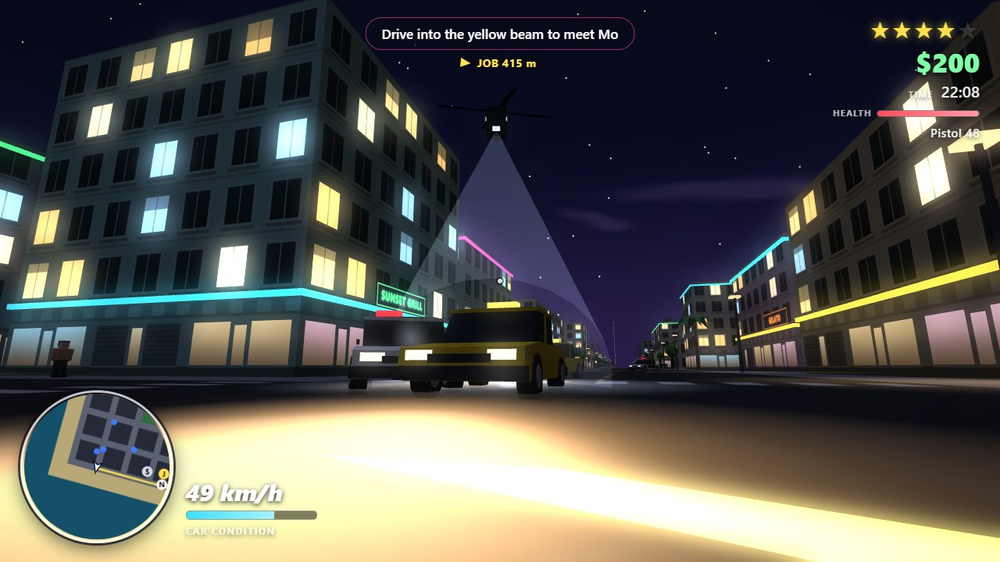
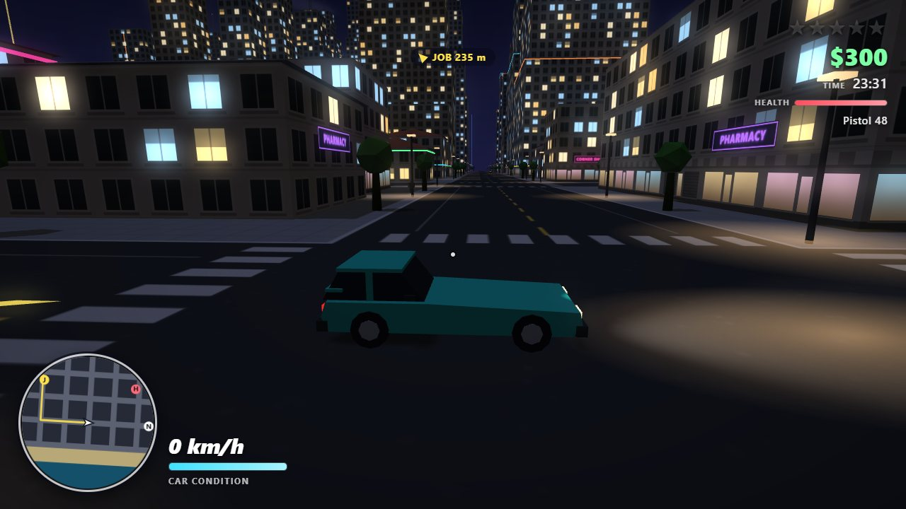
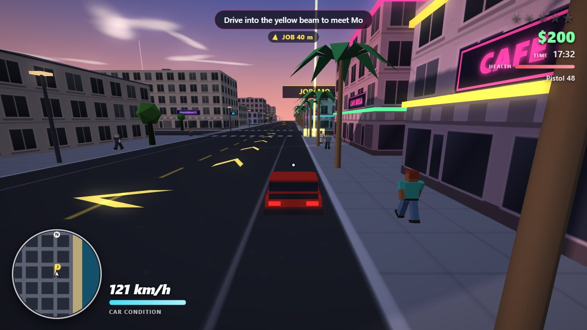
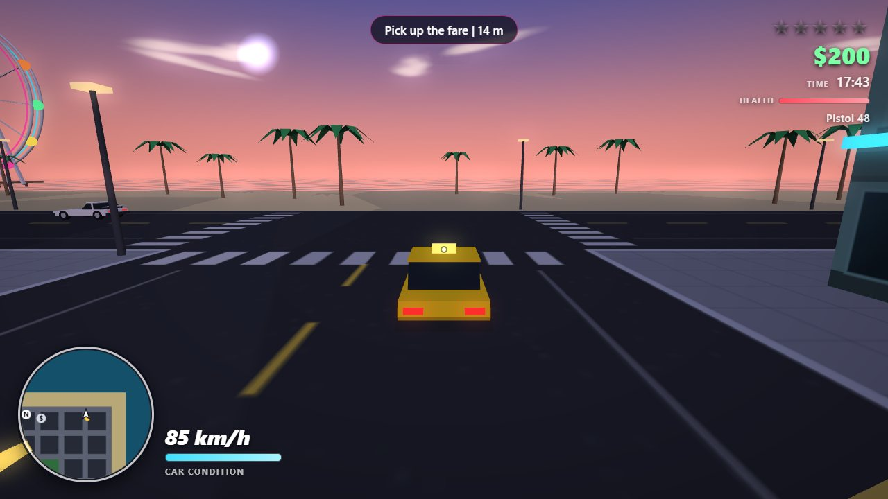
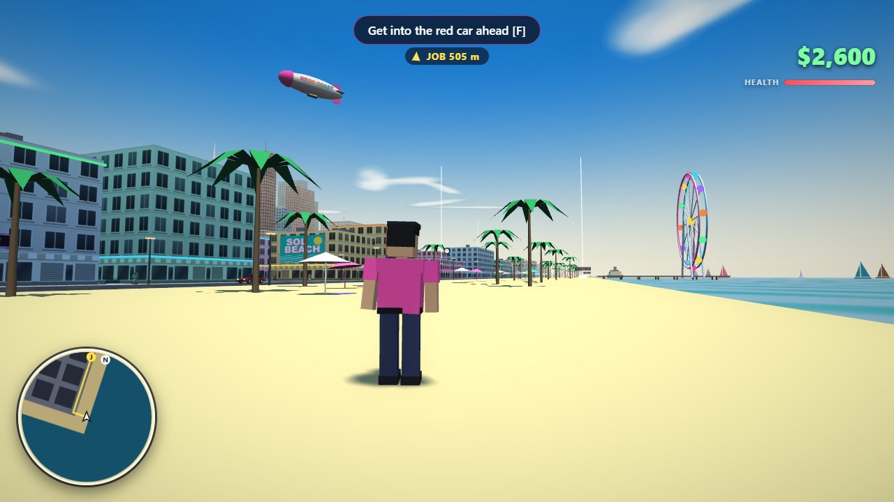
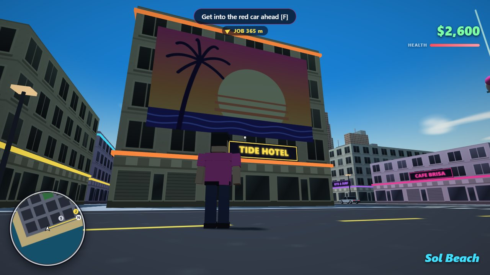
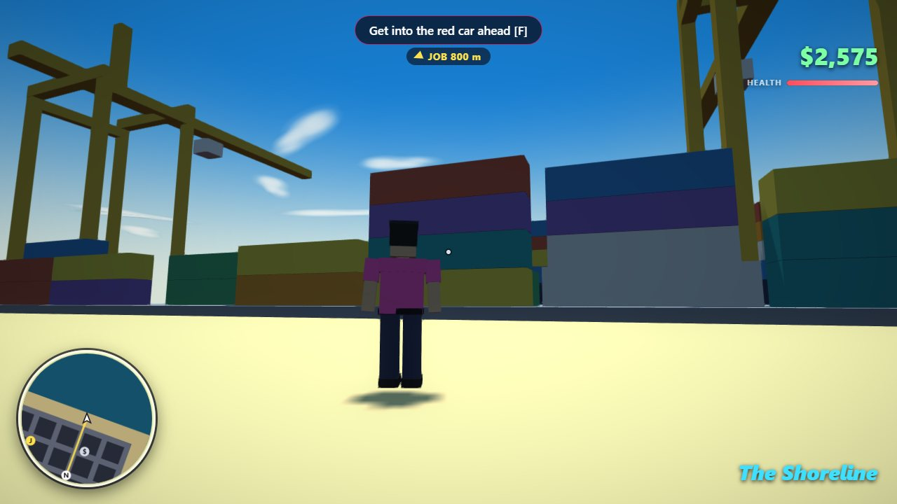
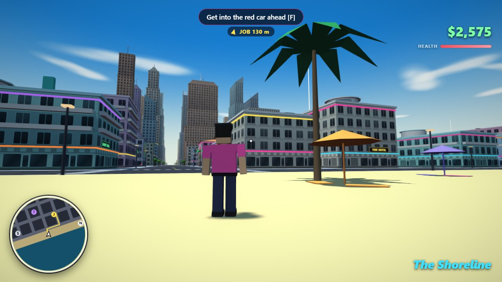
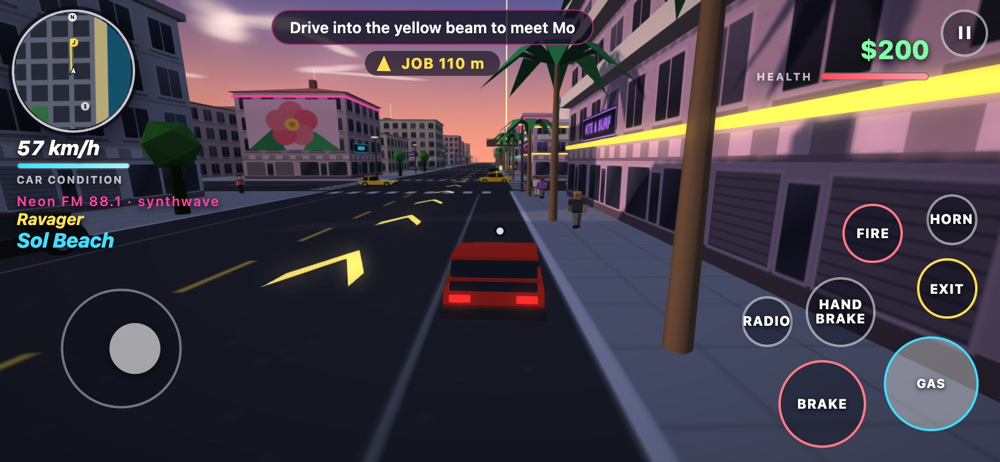

# Neon Coast

[Play in your browser](https://juw12.github.io/neon-coast/) · [Download the offline build](https://github.com/juw12/neon-coast/raw/refs/heads/main/NeonCoast.html)

| | | |
|---|---|---|
|  |  |  |
|  |  |  |
|  |  |  |
|  |  | Screenshots are taken from the running game by `test/smoke.py` and `test/city_shots.py`. |

An original single-player 3D island sandbox in one HTML file: steal cars, run jobs, drive a cab, buy
property, outrun the police. Not a Rockstar product or mod; no Grand Theft Auto installation or assets needed.

On a phone or tablet, open the [play link](https://juw12.github.io/neon-coast/) in Safari or Chrome: the
game switches to touch controls by itself, landscape or upright (see [On a phone](#on-a-phone-or-tablet)).

On a desktop, open NeonCoast.html in Chrome or Edge with WebGL. No server, network, installer or account
needed. Choose New Game or Continue. Walk up to a car and press F. Drive with WASD; Space is the handbrake
and Shift the nitro.
Follow the arrows on the road to the yellow J marker for the first of six jobs. Press M for the whole map
and P to pause. Progress is stored in your browser, so use the same browser and file location to resume.

## Version 2.0.1

2.0 was released with a list of things it had not shown. 2.0.1 goes through that list. Three things in the
game changed because of what the measurements found. The rest is measurement.

What changed in the game:

- **Real time on a slow computer or phone.** 2.0 never moved the game on by more than 0.05 s a frame, so
  under 20 frames a second the whole game ran in slow motion: at 12 frames a second at 0.62 of real time
  on the Windows laptop and 0.49 on a GitHub Mac, at 5 frames a second at 0.25. 2.0.1 cuts a slow frame
  into steps of 1/60 s, up to six a frame. It keeps real time down to 10 frames a second (1.000 at 144,
  31 and 12.5 frames a second, on both computers) and runs at half speed at 5. A car reaches 30% and 60%
  of its top speed at the same moments at 12 frames a second as at 60 (0.638 and 2.187 s).
- **The radio keeps its beat.** At 4 frames a second every note is on the beat, within 1 ms, and none is
  lost. In the same test 2.0 played notes up to 0.47 of a step late and lost four steps.
- **A barrel that went up stays gone for ten minutes of play.** In 2.0 it stood again once you were 150 m
  away, like everything else. `test/barrel_rows.py` found what that was worth. Of the 48 barrels 21 stand
  alone, 6 in pairs, 15 in threes and 6 together on the Rustport dock. One shot from a car: a single barrel
  $90 (the blast and a lamp post it knocks over), a pair $165, three $380, the six on the dock $1,505, a
  chain of seven tricks at x3.5 with one star. That shot paid again on every visit. A story job paid the
  script that drives it $600 for 110 s. Cones, hydrants and lamp posts still stand again at 150 m.

What the list said, and what is known now:

- **"The sums are first guesses."** `test/economy.py` drives into everything it can find for five minutes.
  Three runs on a GitHub Mac: $83, $89 and $183 a minute ($24 to $81 after the fines of 8 or 9 arrests),
  34 to 43 things knocked over a minute, a multiplier of x3 or x4 at most. The script that drives the
  jobs earns $600 in 110 and 112 s (Hot Delivery) and $700 in 108.5 s (Shadow Run), about $330 to $390 a
  minute. So smashing pays a quarter to a half of what a job pays, and the sums stay as they are. The one
  thing that paid more than a job was the row of barrels, changed above. The nitro tank: filled 2.3 to
  3.2 times a minute, burning 12 to 17% of the time and full 30 to 47% of it. It stays as it is too.
- **"The older suites ran on a GitHub computer, not on the PC the game is built on."** Now both. On the
  ASUS, one suite at a time: `gates.py` 10/10 (129 frames a second), `havoc.py` 47/47, `thrill.py` 34/34,
  `chase.py` 13/13, `city.py` 55/55, `radio.py` 14/14, `smoke.py` 22/22, `touch.py` 10/10, `pace.py`
  11/11 and the harbor shift. On GitHub the suites moved to a Mac, which has a graphics card: all ten
  pass at the first attempt for 2.0.1, in two runs of two: the first time every required check is green
  since the suites run on GitHub. The runs after those were not all first attempts, and one was red. What
  that was is under "A red run" below.
- **"Three suites fail there for both builds."** That was the computer. On the Mac the released 2.0 passes
  `chase.py` 13/13 (the cruiser parks 5.7 to 6.9 m behind the car; the 6 m the script asked for was its
  own number and too tight, see "A red run"), `radio.py` 14/14, `gates.py`
  10/10 and `city.py` 55/55 as well. It fails only what 2.0.1 changed on purpose: 5 of 11 in `pace.py`
  and the barrel check of `havoc.py`.
- **"Four Shadow Run checks failed; why was not found."** `city.py` read 55/55 in seven runs of seven, on
  the Mac and on the ASUS, for 2.0 and for 2.0.1. The computer of the failed run drew 8 frames a second, where
  2.0 ran at 0.39 of real time, and those checks wait a fixed time. The fault itself was not replayed.
  Later runs showed a second cause, and it is the script's. It puts its car 100 m behind the pink car every
  30 ms. Nobody gets past the waterline, 477 m from the middle of the map, and the outer road runs 57 m
  inside it. When the pink car turns inland from the outer road, 100 m behind it is out at sea, and the
  game puts the car back on the waterline: 57 m behind, which is under the 60 m that count as close. So the
  game rightly began its eight seconds again and the script's fixed wait ended before the job did. That
  happened three times (once in the red run, twice in the measuring runs, at 58 and 48 m). One hold was
  recorded with its place: the car on the waterline, 36 m from where the script had put it, the gap 64 m at
  its smallest. The two checks now wait for the game to end the job and read the game's own count: 7.95 to
  8.05 s in 103 holds. In half of all holds the car is also carried 5 to 22 m from its spot away from the
  shore; what does that was not looked into.
- **"What the street costs in frames."** On Pretty graphics 1.9 draws 5,931 things in 48 groups, 128,370
  triangles; 2.0 draws 7,504 in 57 groups, about 169,500 triangles, a third more. On a GitHub Mac the
  middle frame took 7.5 to 10.0 ms for 1.9, 7.0 to 8.3 for 2.0 and 5.9 to 9.4 for 2.0.1: under the
  frame cap, no cost that can be measured. With the processor slowed four times: 14.6 to 23.4 ms for 1.9, 22.6 to 26.1 for 2.0,
  24.6 to 30.4 for 2.0.1; slowed six times the three overlap (23.6 to 27.9, 27.5 to 38.6, 25.3 to 32.1).
  With the frame cap off the Mac shows a cost after all: `test/fps_ab.py`, two builds in turn, read 124
  and 138, 140 and 187, 116 and 167, 153 and 153 frames a second for 2.0.1 and 1.9, and 136 and 144, 109
  and 109 for 2.0.1 and 2.0. So 1.9 draws up to 44% more frames when nothing holds it back, and 2.0.1
  draws what 2.0 does. On the ASUS (Intel Arc 140V) the same script read 87 to 135 frames a second for
  2.0.1, 100 and 113 for 1.9 and 122 and 124 for 2.0, on a busy PC: two runs of one build differ more
  than two builds. All of these are above the 60 a screen shows. On a
  computer with no graphics card the game draws 8 frames a second on Pretty and 13 on Fast; there 2.0 ran
  at 0.39 and 0.64 of real time and 2.0.1 runs at 0.78 and 1.00.
- **"What the police make of it."** `test/chase_bench.py` holds a car at 21 m/s on the avenue with the
  stars set and reports what is left of it after 30 s. Its first runs on a GitHub Mac said 2.0 had made a
  three-star chase far harder: 2 of 21 cars still driving for 2.0.1 and 1 of 6 for 2.0, against 14 of 21
  for 1.9. That was the script, not the game. It removed traffic every frame. The game puts a new car on
  the road for each one that goes, 7 in 100 of them a patrol car, and the script left those in. Since 2.0
  the game makes three tries every fifth of a second at speed, not one, and puts 65 in 100 of the new cars
  on the road ahead. So the script drove 2.0.1 into 10 to 17 police cars and 1.9 into 4 to 7, where three
  stars send three. The script now moves traffic out of the way and leaves it in the game, so the game
  adds none. With 3 to 5 police cars for every build the chase is the same: 11 of 16 cars still driving
  for 2.0.1, 12 of 16 for 1.9 and 5 of 8 for 2.0; 32, 31 and 33 health lost to crashes a run; 28%, 28%
  and 35% of the car left on average. At two stars 6 of 6 for 2.0.1 and for 1.9. This is a straight
  chase: the script does not dodge and uses no nitro, ramp or barrel.
- **A slow computer.** Three suites also run on a GitHub Windows computer with no graphics card (8 to 13
  frames a second). They are there to compare and fail no pull request. `chase.py`: 12/13 three times in
  the first run, because the script read the cruiser's speed one frame after the ram; it now reads the
  frame before as well, and the next run read 13/13. `havoc.py`: 46/47 in five runs of six. A bin hit at
  15 m/s leaves the car 0.95 of its speed and the check asks for more than 0.96. In the sixth the car was
  gone half way and 21 checks failed with it. The blast on the dock leaves a star, the suite then rests
  for 5 s, and in that time the police arrested the player and took the car. The script now takes the
  star off before it rests; six more runs read 46/47 and kept the car. `thrill.py`: 33, 33, 32, 33 and 33 of
  34. The getaway seen for 4 s pays $70 where the check expects $60, and once a horn was not heard; a
  sixth run did not start. The checks that fail here were not patched and no limit was changed.
- **A red run.** The third run of the suites needed a second attempt for `touch.py` (the FIRE button on a
  667 x 375 screen; why was not looked into). The fourth ran on a slower Mac and was red for the commit:
  `city.py` and `pace.py` failed three times and `chase.py` passed at its second attempt. The released 2.0
  failed `gates.py` in that run and 2.0.1 passed it. Each failure for the commit in that fourth run was
  traced, on a measuring branch on GitHub, to the script and not to the game:
  - `city.py`, "the hint says Paper Round is on foot". The check before it starts a new game, so the
    first-timer's intro is on again and the player has not left the start spot. Getting into a car there
    makes the intro clear the hint line, and with it the on-foot note the game wrote a moment before. If a
    stunt ramp stands within 45 m of the beam, the ramp tip takes the line next. `test/foot_beam.py` put a
    car on all 61 corners where that beam can stand: the note came at 61 of 61, for 2.0 and for 2.0.1. In
    15 runs of `city.py` the 4 with a ramp within 45 m failed and the other 11 passed, and with the beam
    held on a corner 44.8 m from a ramp 6 of 6 failed (3 for 2.0.1, 3 for 2.0). The script now lets the
    player stand beside the car for 0.3 s first, as somebody who walked to it, and the check also asks that
    the line is on screen: 52 of 52, 12 of them at that corner.
  - `chase.py`, the two-star cruiser that slows down behind the car. The 6 m it had to come within was the
    script's number. The cruiser brakes for a gap of 8 m and parks 5.7 to 6.9 m behind. The check now uses
    the distance at which the game itself makes an arrest, 7.5 m: 13/13 in 6 of 6 runs for 2.0.1 and 6 of
    6 for 2.0 (it came within 6.10 to 6.41 m, at 4.6 to 7.3 m/s; at three stars it arrives at 41.9 m/s).
  - `pace.py`. The bands for 30, 12 and 5 frames a second were bands on the script's own brake on the
    browser, and a slower Mac fell outside them (30.9 to 31.5, 12.67 to 12.72, 4.99 to 5.12 on GitHub).
    They are wider now (26 to 33, 10.5 to 13.5, 4.5 to 5.2). What is asked of the game, the steps a frame
    and the speed of its clock, is as it was: 11/11 in 3 of 3 runs.
  - Shadow Run "loses them": the waterline, above.

  Fixing these turned up four more faults, each in one run of `city.py` among 36: the player out of reach
  of the car after the 0.3 s (fixed: they get in from the car's own spot); a cab shift that had not
  started (the player now boards from the cab's own spot and not a cab standing in the job beam, and the
  script says why if it happens again); "They never showed", the game's own answer when it finds no place
  for the pink car, twice from one spot; and the two property checks failing without a word. The last two
  did not come back in 18 runs and now print what they saw. With the scripts as they are now: `city.py`
  55/55 in 18 of 18 runs on GitHub, and in the suites all ten Mac jobs for the commit passed at the first
  attempt in two runs in a row (45764079399 and 45766576286; the slow computer's `havoc.py` read 46/47
  three times in each, as before).

Still not shown:

- **Whether it is fun.** Nobody has played 2.0 or 2.0.1. That was the verdict on 1.9 and only Juwen can
  change it.
- **The sums were measured by a script, not tuned by play.** They stay because smashing pays less than a
  job, not because anybody found them right.
- **Every barrel on the dock in one chain.** `test/barrel_rows.py` shot all nine groups 1.5 s apart: 27 of
  27 barrels, $10,360 at x4 with four stars. That is an upper bound (the script does not aim and the
  police are taken off the road), and since 2.0.1 it can be had once in ten minutes of play. Loading the
  page again stands every barrel up again; that is as it was, and it is not closed.
- **A chase with nitro, ramps and barrels in it,** and what the patrol cars that the game now puts on the
  road ahead do to a real drive. Both need a script that dodges traffic, and there is none.
- **A real phone.** Still Chrome's phone emulation and WebKit only.
- **The slow computer's failures** listed above.
- **The chase bench and `economy.py` on the ASUS.** It went over its load limit before they ran; their
  numbers are from the GitHub Mac.
- **The hint line at the start spot.** In a new game, getting into a car within 3 m of the start spot
  clears the hint line, whatever is on it. In play that needs a car within reach of that spot, and the red
  car stands 11 m away. Found by the red run and not changed: the game could not be rebuilt and tested on
  the ASUS in this run.
- **Four things in the scripts.** Why `touch.py` once needed a second attempt for FIRE; why the game once
  found no place for the pink car; why the two property checks once failed; what carries a held car 5 to
  22 m from its spot inland. The last three print their own answer the next time they happen.

## Version 2.0 · Havoc

Juwen played 1.9 and said it was still not good enough, with no word on which part. 1.9 had changed how
the car drives and what the police do. In both releases the street itself was scenery: nothing on it
moved, a lamp post let a car straight through, a crash stopped the car dead. 2.0 changes what the street is.

- **The street breaks.** 2,197 things now stand on the kerbs: 474 cones, 410 bins, 232 news boxes, 136
  crates, 225 hydrants, 48 barrels and the 672 lamp posts, which a car drove straight through before. 16
  road works stand in the lanes. A car knocks them flying. What your car knocks over pays into the style
  card of 1.9: a cone $5; a bin, box or crate $10; a lamp post $20 (it needs 7 m/s, and its light goes
  out); a hydrant $25, with a jet of water. Seven cones at 20 m/s: $35, no health and no speed lost. A
  lamp post costs the car 7% of its speed and no health.
  Slower than 2.5 m/s a thing is only tipped over. It all stands again once you are 150 m away (since
  2.0.1 a barrel that went up stays gone for ten minutes of play).
- **Barrels blow up.** Ram or shoot a red barrel: BLAST, $40, a flash, a moment of slow motion. The blast
  reaches 7.5 m, takes up to 26 health off a car (16 at 3 m, and the car is thrown 6 m), throws people,
  and sets off the barrels next to it. One shot at the row of four on the Rustport dock sets off all four
  in 0.8 s. Your own car takes 40% of the blast it set off. The police count a blast as a crime.
- **Twelve stunt ramps.** On the parking strips of eleven streets and on the Rustport dock, each with a
  clear run-up and a clear landing. At 30 m/s (108 km/h) the car flies 37 m, 3.1 m high, for 1.1 s and
  lands unhurt: STUNT JUMP, $40 plus $5 for every 1.25 m, here $190. Under 8 m is a hop and pays nothing.
  Both maps mark the ramps orange, and green once jumped. The longest jump is kept, and all twelve pay
  $2,500. From its tall end a ramp is a wall.
- **Nitro.** Hold Shift in a car. From 12 m/s, 0.6 s of throttle adds 6.4 m/s; with nitro 13.9 m/s. The
  top speed of the test car goes from 152 to 191 km/h. A full tank lasts 3.2 s. It starts half full and
  only play fills it: 3% for each thing knocked over, 20% for a trick, 35% for a stunt jump. An orange
  bar under the car's condition shows the tank.
- **A crash is a move.** A parked car hit square from behind at 20 m/s is shoved 44 m down the road and
  you keep 14 m/s. A hit off the middle turns the other car round: a parked
  car 46 degrees, a driven one 116, your own 9. The driver of a car that was spun has no power for 0.5 to
  1.6 s, so a cruiser can be spun out of a chase.
- **People are thrown.** Somebody hit at 20 m/s goes 1.25 m into the air (0.2 m at 7 m/s).
- **Traffic where you are going.** At 30 m/s, 86% of new traffic is put on the road ahead of you
  (standing still 47%), so a fast drive has cars to pass.
- **On a phone.** A NITRO button next to GAS; it is the gas as well, so one thumb does both. RADIO moved
  to make room.
- **A new test.** `test/havoc.py` holds every rule above, 46 checks on the game's own clock. The 1.9 build
  passes 2 of the first 45. Its first runs found five faults in the new code, all fixed before release: a
  shot barrel never blew at 60 frames a second; 44 things stood inside or against a street tree; a walker
  added without a home block stopped the page; a hit on a corner turned a parked car only 23 degrees; a
  car put back on the road by the game was paid as a 303 m jump. The older suites found two more:
  `touch.py`, that a new hint named a key on a phone; `city.py`, that the tip said once near the first ramp
  took the hint line from a job. A tip now waits until the line is free, and check 46 holds that.

What this did not show when it was released (2.0.1, above, goes through this list):

- **Whether it is good enough now.** A script can check that a barrel takes 16 health at 3 m. It cannot
  say whether that is fun. Nobody has played 2.0 yet.
- **The sums are first guesses.** $5 to $40 for what is knocked over and $190 for a long jump stand next
  to story jobs that pay $250 to $3,500. They were not tuned by play; nor was how fast the tank fills.
- **What the police make of it.** A blast counts as a crime and a cruiser can be spun out. How a whole
  chase goes with barrels, ramps and nitro in it was not measured (`test/chase_bench.py` was not run).
- **No real phone.** The NITRO button ran in Chrome's phone emulation only.
- **The older suites ran on a GitHub computer, not on the PC the game is built on.** That PC was over its
  load limit with other work. The GitHub computer has no graphics card and draws 9 to 13 frames a second, so
  each suite ran there for 2.0 and for 1.9 side by side, up to three attempts each
  (`.github/workflows/suites.yml`). On the last run, for 2.0: `havoc.py` 46/46, `thrill.py` 34/34,
  `smoke.py` 22/22, `touch.py` 10/10 and the harbor shift, all at the first attempt. Three suites fail there
  for both builds. `chase.py`: the cruiser that has to stop less than 6 m behind the car stops further
  back, and the two checks after it are not reached: 6.45 to 6.97 m for 2.0 in seven runs of seven, 5.96 to
  6.45 m for 1.9, which passed one run of seven. `radio.py`: 11 or 12 of 14.
  `gates.py`: on the last run it finished for neither build (a screenshot times out after 30 s); on the
  first run, on a faster computer, it read 9/10 for 2.0 and 8/10 for 1.9. `city.py` read 53, 49 and 53 of 55
  for 2.0 and 50, 50 and 51 for 1.9: the cab fare, the helicopter and the ten-second head start wait a fixed
  time. The run of 49 failed four Shadow Run checks that 1.9 failed in no run; why was not found.
- **What the street costs in frames.** 2,197 more things are drawn. On the GitHub computer the frame rate
  gate read 11 frames a second for 2.0 and 13 for 1.9 on one run, and 9 for both on the next two. With a
  graphics card or on a phone it was not measured (`test/fps_ab.py` was not run).

Saves from 1.9 carry over (half a tank, no ramps jumped).

## Version 1.9 · Sideways

The first person to play 1.8 said it was not fun enough. This release works on six things: the jobs, how
the car drives, the police, the city, what there is to do between jobs, and the phone.

- **Odd jobs open after the first story job.** Before, **J** offered an odd job only when all six story
  jobs were done, so the story was the only thing to do for the first hour. Now **J** goes from the story
  job to an odd job and back, and each time round the odd job is another kind. On a phone the pause screen
  has the button for it.
- **The handbrake slides the car.** Hold Space with the wheel turned and the car swings round the corner
  and keeps its speed; let go and the tyres grip again within a second. With the wheel straight the
  handbrake is the brake it was. From 24 m/s (87 km/h), 0.9 s of handbrake and full lock: 1.8 turned the
  car 68 degrees and left it at 14 m/s, 1.9 turns it 84 to 91 degrees (three runs) and leaves it at 22 m/s.
- **Near misses and slides pay.** Pass a moving car at over 14 m/s with less than 1.8 m between you and it
  is a near miss: $25, or $50 past a police car. A slide pays $30 a second from 0.6 s on. Each trick goes on
  a card under the job line; another trick within 4 seconds adds half to the multiplier, up to four times.
  The sum is paid when the bar on the card runs out. A crash loses it. With wanted stars on, every trick
  pays double.
- **Losing the police pays.** Get out of their sight until they give up: $150 at two stars, $400 at three,
  $800 at four, $1,400 at five, by the most stars the chase reached. The full sum needs the police to have
  had you in sight for 10 seconds; less time pays that share. One star pays nothing. A bar under the stars
  (LOSING THEM) shows how close they are to giving up; before, the only sign was the stars blinking.
- **Two stars: no shooting at a moving car.** The open item of 1.8: with the ramming gone, gunfire was what
  wore the car down in a two-star chase. Now officers at two stars shoot only at a player on foot or in a
  car slower than 8 m/s (29 km/h). From three stars they shoot at a moving car as in 1.8.
- **A busier city with a voice.** 20 cars driving and 11 parked around you (before 15 and 9), 34 people
  walking (before 26). A driver who has to wait behind something sounds the horn after 1.2 s, each kind of
  car with its own note; a driver you pass too closely does too. With no stars on you a patrol car now and
  then answers a call somewhere: siren on, 24 m/s through the traffic, and not after you.
- **Speed can be heard and seen.** The engine has five gears: the note climbs through each and drops at the
  change; its low octave joins only when the engine works, so an idling car does not drown the radio. Tyres squeal in a slide, wind is heard from 50 km/h. The body leans out of a turn, squats under
  power and dips under the brakes. The lens widens up to 20 degrees with speed (before 14) and the edges of
  the screen darken from 80 km/h; near its top speed the car trembles.
- **On a phone.** HAND BRAKE with the stick pushed over slides the car and keeps the power on, since one
  thumb cannot hold GAS and HAND BRAKE together (the same 0.9 s slide leaves the car at 21 m/s; on 1.8 it
  left it at 6). The stick is finer near its middle: half the stick is a third of the wheel. On Android a
  crash is felt as a short vibration.
- **A new test.** `test/thrill.py` holds every rule above, 34 checks on the game's own clock. The 1.8 build
  passes 11 of them (the ones that say what must stay as it was).

What this does not show:

- **Whether it is more fun.** A script can check that a slide keeps its speed and that a near miss pays
  $25. It cannot say whether that is fun. Nobody has played 1.9 yet.
- **The sums are first guesses.** $25 for a near miss and $150 to $1,400 for a getaway stand next to story
  jobs that pay $250 to $3,500. They were not tuned by play.
- **No real phone.** The touch changes ran in Chrome's phone emulation only.
- **The offline reload on the build PC.** `test/touch.py` passes 9 of 10 there: "installs and plays
  offline" times out, for the 1.8 build in the same way (3 of 3 runs each). Why was not found.

Saves from 1.8 carry over.

## Version 1.8 · Fair Cop

The police chase is fairer. Nothing else changed.

- **Two stars is a chase, three is a ramming.** At two stars a cruiser now slows down as it reaches your
  car and stays on your bumper; officers still shoot, and they still arrest you when you stop. Before, a
  cruiser with a clear view drove into you at its top speed from two stars on. From three stars it still does.
- **Being rammed is not your crime.** A crash with a police car adds to your stars only when you drove
  into it: your own speed towards the cruiser must be over 5 m/s and at least the cruiser's speed towards
  you. Before, every crash with a police car added 1.3 wanted points, also when a cruiser hit you from
  behind while you stood still, so a chase raised its own stars.
- **One crash cannot take the whole car.** One crash with a cruiser costs your car at most 40% of its full
  health on Normal, counting every hit in the 0.6 s after the first one, also the wall you are shoved into.
  Before, one head-on ram took about three quarters of a car. Crashes without a police car are as before.
- **A moving car is harder to shoot.** Officers hit a standing car as often as before. The faster the car,
  the fewer shots hit: from 30 m/s (108 km/h), 40% as many.
- **Two new tests.** `test/chase.py` sets up crashes, gunfire and a pursuit and checks the four rules.
  `test/chase_bench.py` measures how long a car lasts in a chase. The numbers are in the Tests section.

Measured, 1.7 against 1.8 (the tables are in the Tests section):

- **In a set chase the car lasts.** A Vanta GT held at 21 m/s (76 km/h) for 30 s of game time with the
  other traffic removed. At two stars on 1.7, every run the police found (4 of 7) ended with the car
  wrecked, after 12.7 to 23 s, and the stars rose to three in 4 of the 7 runs. On 1.8, 5 of 6 runs were
  found and all five cars were still driving at 30 s, with no crash damage at all; the stars stayed at two.
  At three stars 1.7 wrecked the car in 3 of 3 runs and the stars rose to four; 1.8 wrecked it in 3 of 11
  and the stars stayed at three.
- **What it did not do.** The script that plays the jobs with key presses finishes the two police jobs
  about as often as before: Borrowed Time 3 of 6 runs on 1.7 and 2 of 3 on 1.8, Heat Wave 0 of 3 on both.
  Three runs are too few to tell those apart. Gunfire is now what wears the car down: in the two-star
  bench it took 48 to 84 of the car's 90 health in 30 s. That is the next thing to look at.
- **No person has played 1.8.** The rules are checked by script only.

Saves from 1.7 carry over.

## Version 1.7 · Tail Lights

- **A sixth odd job that is not a race.** Shadow Run: Rico wants a car followed. Stay 12 to 60 m behind
  the pink car for 40 seconds. Closer than that for three seconds and the driver spots you; further for
  eight and you have lost them. For the first twenty seconds a gap does not count: catch up. No clock,
  no marker to reach. It pays $700.
- **The first job starts where you stand.** The yellow beam is now in the red car's own lane, 40 m ahead
  of the start spot: get in, roll forward, the job begins. The whole first job is about 270 m instead of 470.
- **Paper Round says it is on foot.** The beam is labelled ON FOOT, and the round does not start from a
  driver's seat: a line tells you to leave the car first, before the clock runs.
- **A head start in Borrowed Time.** Taking the marked car gives ten seconds before the two stars arrive
  (eight seconds and one star in the Repo Run odd job).
- **A marked way out of the heat.** In Heat Wave and Hot Parcel the road arrows lead to Mo's Respray while
  you are wanted. Losing the police out of their sight still works as before.
- **A working dock.** The shore in front of the Rustport quay is a concrete apron with a truck lane, a
  crane rail and a hazard edge; the quay has mooring bollards, floodlight masts and yard tractors. Both
  maps show it.
- **See-through buttons on a phone.** The touch buttons are fainter, so the road shows behind them.
- **All six story jobs are now played by key presses in the tests**, and so is Shadow Run. The Tests
  section below says how often the script finished each one: the two police jobs are still the hard ones.

Saves from 1.6 carry over.

## Version 1.6 · Sharp

- **A picture as sharp as the screen.** Graphics has a third choice, **Auto**, and a phone starts on it.
  1.5 started phones on Fast: 1.5 drawn pixels per point, no glow, no shadows. Auto starts at 2 pixels per
  point with the neon glow and adds shadows when the frame rate allows.
- **It measures while you play.** Below 40 frames a second it gives up shadows first, then the glow and
  half the crowd, and drawn pixels last, never under 1.5 per point on a touch screen. A step that buys no
  frame rate is given back. Above 55 for a while it climbs again. Fast and Pretty stay fixed choices.
- **Shots find their target.** On a touch screen each shot first turns the view onto the nearest target
  close to the crosshair (police first when you are wanted). Sliding the thumb on FIRE still aims by hand.
- **Arrows to steer.** Settings, Steering: Stick or Arrows. Arrows puts two buttons under the left thumb
  while you drive; on foot the stick stays.
- **CAR lights up** when a car is close enough to take, and buttons tick under the thumb on Android.
- A phone that played 1.5 is moved from Fast to Auto once; what you pick after that is kept.

## Version 1.5 · Pocket

- **Touch controls.** A thumb stick on the left walks and steers; GAS, BRAKE, HAND BRAKE and the rest sit
  under the right thumb. Drag anywhere else to look around. The buttons change with what you are doing:
  on foot, in a car, on the Sol Wheel.
- **Landscape or upright.** The screen rearranges itself for both. Landscape shows more road; upright
  widens the lens so the street still fits.
- **An icon on the home screen.** From the web address the game can be installed: it then opens full
  screen and plays with no network.
- **A sky on Safari.** On Fast graphics Safari drew the sky black. Fixed.
- Keyboard and mouse play exactly as before, and NeonCoast.html is still one file that runs on its own.

## On a phone or tablet

Open <https://juw12.github.io/neon-coast/> in Safari (iPhone, iPad) or Chrome (Android).

| On its side | Upright |
|---|---|
|  |  |

| Control | What it does |
|---|---|
| Left thumb, lower left | A stick appears under it. Walk, or steer the car. Push it right out to sprint. Settings can give the car two arrows instead |
| Drag the view | Look and aim |
| CAR / EXIT | In or out of any car |
| GAS, BRAKE, HAND BRAKE | Drive. BRAKE at a standstill reverses |
| NITRO | Next to GAS, since 2.0. It is the gas as well, so one thumb does both |
| FIRE / PUNCH, SWAP | Shoot or punch. Shots find a target near the crosshair; slide the thumb on FIRE to aim yourself. SWAP changes pistol and fists |
| JUMP, HORN, RADIO | As named |
| USE, CAB | Appear when they apply: in a property or Sol Wheel ring, in a City Cab |
| The round map | Tap for the whole island, tap again to close |
| II | Pause. The pause screen also starts the harbor courier shift and picks another odd job |

**Install it.** iPhone or iPad: Share, then *Add to Home Screen*. Android: browser menu, then *Install app*
or *Add to Home screen*. The icon opens the game full screen, and after that first visit it plays offline.
On an iPhone this is the only way to get rid of Safari's bars; on Android the game also goes full screen
by itself when you start.

**Good to know.** A phone starts on Auto graphics (see 1.6); Fast and Pretty are fixed choices in the
settings. On an
iPhone the ring/silent switch also silences the game. Progress is stored per browser, so Safari and the
home-screen icon each keep their own save. A laptop with a touch screen switches to touch controls at the
first finger; adding `?touch=1` to the address shows the phone layout with a mouse, `?touch=0` keeps
it off.

The phone files are `manifest.webmanifest`, `sw.js` and `icons/` (drawn by `tools/make_icons.py`). They
are only asked for on a web address; the single HTML file opened from disk asks for nothing.

## Version 1.4 · Skyline

- **Buildings with outlines.** No more plain boxes: roof lips everywhere, slanted and stepped crowns, corner
  fins and water tanks on the Meridian towers, balcony bands and round penthouses on the Sol Beach hotels,
  saw-tooth roofs and yards in Rustport, chimneys in the suburbs. Beyond the Rustport waterline there is a
  quay with container stacks, three gantry cranes and a freighter.
- **Smoother edges.** A second anti-aliasing pass on Pretty graphics.
- **A learner phase.** Until your first job is done, crimes bring no stars, so the first minute cannot end
  in an arrest. After it the police watch you as before.
- **A fifth odd job, on foot.** Paper Round: four envelopes round one block against the clock for $550.
  After the story, **J** asks the contacts for another kind of odd job.
- **Three radio stations in three styles.** Neon FM (synthwave), Coast 98 (beach pop) and Low Tide (late
  night) now differ in drums, bass and tune, not only in speed. **R** in a car turns the dial.
- **More of the game played by key presses in the tests.** `test/drive.py` now plays three story jobs.

Saves from versions 1.0 to 1.3 load as they are.

## Version 1.3 · Clear Day

- **A first job inside a minute.** Get in the red car, drive to the job beam, follow the beach road to the
  Sol Wheel pier. It used to end at the respray shop on the far side of town. Until that job is done your
  car smokes when battered but cannot be wrecked.
- **Ride the Sol Wheel.** Walk to the foot of the pier and press **E** ($25). The camera goes once round the
  wheel over the beach and the city; the ride patches you up and marks the three nearest hidden packages
  with a **?** on the map. **F** gets off early.
- **A city with a daytime look.** 86 painted walls in eight designs, two per district. Parasols and towels
  on the sand, sailing boats, gulls, and the Coastliner airship lapping the island. Teal sea, warm horizon,
  walls shaded from foot to top, new colours for the Meridian towers and the Rustport sheds.
- **Police heat reaches everything.** With stars on you no cab passenger gets in, the Tune-up shop is shut
  and the wheel sells no ticket. Walking into a property you own loses the police at one or two stars.
- **Perks you can see coming.** Each package, fare or job shows a card with the distance to the next perk
  ("Body armour 4 / 5"), and an unlock is announced with what it gives.
- **A quieter screen.** The HUD is cash and health. Stars show only when you are wanted, the weapon line for
  five seconds after it changes, and the clock moved to the map and pause screens. The pause screen is three
  buttons, settings and perks; the map legend sits on the map (**M**). The title screen shows six keys.

## Version 1.2 · City Lights

- **Cab fares.** Take any yellow City Cab and press **T**. A passenger waves from the kerb: stop in the ring
  to pick up, stop in the next ring to drop off before the clock runs out. Pay is $60 plus $0.38 a metre, a
  tip for spare seconds (at most half the fare) and 10% more for each fare in a row, up to 50%.
- **Property.** Four places carry a **$** on the map. Walk into the ring and press **E** to buy ($2,000 to
  $14,000). Each pays rent by the game hour, holds up to six hours of it, and patches you up when you walk
  back in.
- **Police helicopter.** At four stars a helicopter flies in with a searchlight and keeps you in sight from
  above, so a side street no longer hides you. At five stars its gunner fires. A respray still clears it.
- **Finding the way.** Arrows on the road in your lane and a line on the minimap lead to the current
  target. **M** opens a map of the whole island with every place, your properties and the route.
- **Perks.** 5 hidden packages: 25% less damage. 10 packages: respray at half price. 10 cab fares: double
  tips. All six story jobs: 50% more rent. The pause screen shows your progress on each.
- **Odd jobs in four kinds** after the story: Rush Order, Repo Run, Block Dash and Hot Parcel (five since 1.4).
- A brighter night: lit windows, shop fronts, neon and lamps glow on Pretty graphics.

## Harbor courier shift

Choose **Harbor courier shift** at the title screen for the Hauler van, or press
**G** between story jobs using any vehicle. Stop in the numbered amber rings:
film cans at Reel Lab, a projector lamp at Electric Works, then Pier 03.
The departure clock starts once you have wheels. Earn $450 plus a time bonus;
your quickest successful run is saved separately from the six story jobs.
Pause to cancel the shift.

## Tune-up shop and landmarks

The cyan **T** on the map is the Tune-up shop. Stop your car in the ring to buy the next of three stages
($1,500, $3,000, $6,000). Each stage adds 14% acceleration and 7% top speed to the car you drive and is kept
in the save. Driving through without stopping buys nothing.

Things to steer by: the Sol Wheel (a turning Ferris wheel on a pier off Sol Beach), the Coastliner airship, the Meridian
Spire on the tallest tower, red-light masts on the other towers, smokestacks over Rustport and the gantry
cranes on its quay, and pitched roofs on the low suburb houses.

## Tests

Needs Python with Playwright and Chrome. Run from this folder after `python build.py`:

- `python test/gates.py` - ten pass/fail gates (offline single file, clean console, the core loop with 22
  checks, all six jobs pay, arrest, mouse look, frame rate, HUD overlap at three sizes, own names, clear first view).
- `python test/harbor.py` - the harbor courier shift from start to payout, cancel and timeout.
- `python test/city.py` - 55 checks (54 before 1.9: the one **J** check during the story became two, for the
  new rule) on cab fares, property, perks, the helicopter, the route, the map,
  saves from older versions, the Sol Wheel ride, what the police stars switch off, the learner phase, the
  **J** key, the Paper Round and its ON FOOT start rule, the building outlines, the near first beam,
  Shadow Run (seen, lost, a slow start, passed), the head start and the respray route. The Shadow Run and
  head-start checks wait on the game's own clock. Other checks still wait a fixed time, so on a busy PC a
  timer check can fail: on 1.7 it read 52, 52 and 54 of 54 in three runs in a row (a cab fare paid late,
  the helicopter not yet gone), and before the two checks used the game clock 52, 51, 51 and 49.
- `python test/chase.py` - 13 checks on the police chase rules of 1.8 (since 1.9 the two checks on shots at a
  moving car run at three stars, because two stars no longer shoots at one), all waiting on the game's own
  clock: a cruiser ramming a standing car adds no wanted points, driving into a cruiser still does, one
  crash with a cruiser takes at most 40% of the car (also when it shoves the car into a wall), a crash with
  no police car is as before, officers hit a standing car as often as before and a fast one less, at two
  stars a cruiser with a clear road slows down and stays behind the car, at three stars it rams. The 1.7
  build fails 4 of the first 8 checks.
- `python test/thrill.py` - 34 checks on what 1.9 added, all waiting on the game's own clock: the handbrake
  is a brake with the wheel straight and a slide with it turned (speed kept, degrees turned, grip back
  within a second, body lean, tyre noise), a near miss pays and a wide or slow pass does not, three in a
  row pay double, a crash loses the chain, stars double a trick, no shot at a moving car at two stars and
  shots again at three, what a getaway pays by stars and by seconds in sight, the LOSING THEM bar, a horn
  from a driver who has to wait, a patrol car on a call, five gears, wind, the wider lens, **J** before and
  after the first story job, the number of cars and people, and the phone controls for the slide. Give it
  another build to see which rules are new: `python test/thrill.py old.html` reads 11 of 34 on 1.8.
- `python test/havoc.py` - 47 checks on what 2.0 added, all waiting on the game's own clock: how many
  things stand on the street and that none stands in a tree, at a job stop, a shop or a door; what a cone,
  a lamp post and a barrel cost the car and pay; that a slow car only tips a thing over; a blast by
  distance, on a parked car, on people and on the next barrel; a ramp at 30 m/s and at 10 m/s, the map
  marks and the reward for all twelve; that a tip said once waits for a free hint line; the nitro tank,
  what fills it and what it adds; a parked car shoved, a car spun and its driver stunned; a person thrown;
  traffic put ahead at speed; the NITRO button on a phone; a save from 1.9; since 2.0.1 that a barrel
  that went up stays gone for ten minutes of play. `python test/havoc.py old.html` reads 2 of the first
  45 on 1.9 (check 46 came later and was not run on 1.9) and 46 of 47 on 2.0.
- `python test/pace.py` (since 2.0.1) - 11 checks on how fast the game runs when the screen is drawn
  slowly. The script holds every frame back to get about 30, 12 and 5 frames a second, and reads the
  game's clock against the real one, the number of steps a frame, how long a car takes to reach a speed
  and to brake, and whether the radio's notes stay on the beat at 4 frames a second. 2.0 passes 5 of 11.
- `python test/economy.py` (since 2.0.1) - not pass/fail. A script drives into everything it can find
  for five minutes and prints what that paid a minute, how many things it knocked over, the highest
  multiplier, how often the nitro tank filled and how long the nitro burned.
- `python test/barrel_rows.py` (since 2.0.1) - not pass/fail. One shot at every group of barrels that
  go up together, from a car 14 m away, and what each chain paid; then one shot at every group 1.5 s
  apart, all in one chain. The last number is an upper bound: the script does not aim, the car is moved
  by script and the police are taken off the road.
- `.github/workflows/suites.yml` (since 2.0) runs ten suites on a GitHub computer for each pull
  request that changes more than Markdown: once for the build of the commit and once for the last release from its own tag, up to three
  attempts each, with the logs kept. For 2.0 that was a Windows computer with no graphics card (9 to 13
  frames a second). Since 2.0.1 it is a GitHub Mac, which has one. A browser without a window draws
  there at 14 to 28 frames a second under its own frame cap and at 75 to 210 with the cap off, so the
  suites run with the cap off (`NEON_CHROME_ARGS`). With the cap off a screenshot now and then waits 30 s
  for a frame, so the three suites that take screenshots (gates, smoke, touch) keep the cap, and the
  frame-rate gate alone is measured in a browser of its own (`NEON_FPS_UNCAPPED=1`). Three suites
  (chase, havoc, thrill) also run on the Windows computer as "a slow computer"; they are there to
  compare and do not fail the pull request, and neither do the runs for the last release.
  `test/thrill.py` had three set-ups made steady for it (a patrol car put in a lane, the crowd counted as
  a median over 4 s, the horn taken from a car that drives towards the player; no limit changed), and
  `test/harbor.py` prints where the van is when a stop does not load.
- `python test/chase_bench.py NeonCoast.html 2 21` - how long a car lasts in a chase. It holds a Vanta GT
  at a set speed (here 21 m/s) at a set number of stars (here two) for 30 s of game time, with the other
  traffic out of the way, and reports whether the car was wrecked, the stars at the end, the damage from
  crashes and from gunfire, the most police cars on the map and where each crash was. Police arrive at
  random, so some runs are never found; those are listed, not counted as survived. Until 2.0.1 the script
  removed traffic every frame, and the game then put new cars on the road, 7 in 100 of them patrol cars
  the script left in (`... 3 21 8 old` still counts that way). The table below was measured like that.
  1.7 and 1.8 put new cars on the road in the same way, so the two were compared under the same fault;
  the numbers for 1.9, 2.0 and 2.0.1 measured the new way are under Version 2.0.1.

  | stars | build | runs | never found | chased and wrecked | stars at the end |
  |---|---|---|---|---|---|
  | 2 | 1.7 | 7 | 3 | 4 of 4 (12.7, 15.5, 20.4, 23 s) | three in 4 of 7 runs |
  | 2 | 1.8 | 6 | 1 | 0 of 5 (health left 47, 19, 7, 47, 13%) | two in all |
  | 3 | 1.7 | 3 | 0 | 3 of 3 (20.7, 27.4, 29.2 s) | four in all |
  | 3 | 1.8 | 11 | 0 | 3 of 11 | three in all |

  Crash damage at two stars on 1.8 was 0 in every run; gunfire took 48 to 84 of the car's 90 health.
  Without the two-star pursuit rule (the other three rules only) 3 of 8 two-star runs were wrecked and
  one was never found. At three stars gunfire took about 55 health on 1.7, in runs that ended after 21
  to 29 s, and about 41 in 30 s on 1.8; one of the eight 1.8 cars that lasted had under 1% health left.
  Eight of the eleven three-star 1.8 runs were made on a build without the two-star rule, which does
  not act at three stars (3 of those 8 wrecked; 0 of the 3 on the final build).
- `python test/radio.py` - 14 checks that record the three radio stations at the game's master output and
  measure them: loud enough, no clipping, the beat repeating at each station's own tempo, different tone.
  It cannot tell whether the music is pleasant.
- `python test/drive.py 5` - plays the first story job five times with key presses only (W A S D, F, J and
  Space; nothing is moved by script) and reports how many runs finished. `python test/drive.py 3 2` plays
  job 2 three times; jobs 3 to 6 and `tail` (Shadow Run) are asked for the same way. For every job but the
  first the save file is first set to "earlier jobs done". On foot the script walks along the pavements to
  the nearest parked car. A try that fails is tried again inside the run's time limit, and the result lists
  the tries, the arrests and the reason the game gave. Traffic is random, so results vary.

  Tail Lights before it was merged with 1.6 Sharp (the driving, police, job and keyboard code is the same
  in 1.7: Sharp changed the graphics settings, the touch aim and steering and one save default), one run
  at a time:

  | job | finished | time | what went wrong |
  |---|---|---|---|
  | 1 First Wheels | 3 of 3 | 29.7 to 47.9 s (1.4: 38.5 to 50.9 s) | |
  | 2 Hot Delivery | 2 of 2 | 146.8 and 222.1 s | |
  | 3 Midnight Sprint | 1 of 2 | 279.7 s, second try | other tries ran out of the race clock (measured with a second test running) |
  | 4 Borrowed Time | 1 of 2 | 204.9 s, first try | the other run: stolen car wrecked by police cars, twice |
  | 5 Heat Wave | 0 of 3 | - | arrested or taken out 8 times in 8 tries, up to five stars |
  | 6 Coastline Run | 1 of 1 | 211.2 s, first try | |
  | Shadow Run | 3 of 3 | 109.5 to 205.8 s | first try once, second try twice (spotted once, lost them once) |

  The same script is much worse when the PC is busy. Earlier the same day, with two or three browsers
  running at once and the frame rate down to 18 to 50 a second, job 2 finished 1 of 4 runs, job 5 0 of 4
  and job 6 0 of 2; job 4 finished 0 of 8 (four of those with other browsers running, four before the
  script learnt to walk along the pavements, when it could get stuck in an alley after an arrest). Two more
  runs of job 3 did not finish and their result file was lost. Releases 1.5 and 1.4 were tried in the same
  hour: 1.5 finished job 4 0 of 2 and job 2 0 of 1, 1.4 finished job 2 1 of 1. So run this test alone.

  On the merged 1.7 build, on the same busy PC in the evening: job 1 finished 3 of 3 (56.4, 80.8 and
  187.0 s; the game runs slower than the clock when the frame rate drops under 20 a second) and Shadow Run
  2 of 3 (199.0 s on the first try, 211.5 s on the second; in the third run the player was taken out on the
  way to the job beam and did not reach it in 421 s). Jobs 2 to 6 were not played again on 1.7.

  What it showed about the game on 1.7: the two police jobs are the hard ones. At two stars a police car
  with a clear view drove straight at the player at top speed, one head-on hit took most of the Vanta GT's
  health, and every such hit also counted as a crime, so the stars climbed. The 10 s head start in 1.7 did
  not change that. Release 1.8 changes those three rules and the gunfire against a moving car.

  The two police jobs again on 1.8, 1.7 and 1.8 playing at the same time on a busy PC, three runs each:

  | job | 1.7 | 1.8 | what went wrong |
  |---|---|---|---|
  | 4 Borrowed Time | 3 of 6 (most stars 5, 2, 4 and 4, 5, 3) | 2 of 3 (stars stayed at 2) | on 1.8 the stolen car was still destroyed 4 times in the three runs |
  | 5 Heat Wave | 0 of 3 (five stars in all) | 0 of 3 (most stars 3, 4, 3) | arrested or taken out on every try |

  So the stars no longer climb on their own, and the script finishes the two jobs about as often as
  before. Three runs cannot tell 2 of 3 from 3 of 6. Two things are left: gunfire, which is now what
  destroys the car at two stars, and the script itself, which stops for traffic while it is chased and
  never tries to get out of sight. The Heat Wave runs on 1.8 were made on a build without the two-star
  pursuit rule (Heat Wave is a three-star job, where that rule does not act); why the player dies on foot
  there was not looked into. Jobs 1 to 3, 6 and Shadow Run were not played again on 1.8.

- `python test/touch.py` - touch play in Chrome emulating a phone at four screen sizes, landscape and
  upright, with real touch events (two fingers where two thumbs are needed): every button, the stick, the
  look drag, the map, pause, the Sol Wheel; nothing overlapping or off screen; every hint naming a button
  and not a key; the desktop page unchanged; the manifest, icons and an offline reload from a local web
  server; and, if Playwright's WebKit is installed (`playwright install webkit`), a run on Safari's engine.
  Release 1.6 has ten checks and read 10 of 10 on the Mac. On the Windows laptop 1.7 read 7, 9 and 7 of 10
  on a busy evening: in the best run every Chrome check passed and only the Safari-engine check failed
  (4 frames in 1.5 s, then a lost WebGL context); in the other two the small-phone checks timed out and
  the aim-assist check failed once. That Safari-engine check alone fails the same way for the released 1.6
  (2 of 2 runs) and for 1.7 (2 of 2) on this laptop, whose software WebKit cannot keep up with the Auto
  graphics of 1.6 while other work is running. Before the merge, Tail Lights read 9 of 9 alone. A clean 1.7
  run on the Mac is still to do.

- `python test/fps_ab.py NeonCoast.html other-build.html` - frame rate of two builds measured in turn, for
  when the PC is busy and the frame-rate gate reads low.
- Every suite reads two switches: `NEON_WINDOW=1` opens a real window instead of a headless browser, and
  `NEON_CHROME_ARGS` adds Chrome flags.

Apart from the six story jobs and Shadow Run, jobs are passed by script (the car or the player is moved
between markers), so the tests do not measure how hard the other odd jobs, the cab fares or the courier
shift are. A script is also not a person: it reads the game state and never gets lost, so even a job it
finishes may be harder or easier for a player. Tested in Chrome on one Windows laptop and one Mac. The
touch controls were tested in Chrome's phone emulation and Playwright's WebKit on both, not yet on a real
iPhone or Android phone, so frame rate and feel in the hand are unknown. No gamepad controls. No real
players have tried it yet; the scores in `hone/refine_log.md` come from AI judges reading
a fact sheet and screenshots. `hone/rubric.md` holds the scoring rubric.

## Edit and rebuild

Edit the JavaScript modules or the HTML template in src/, then run
`python build.py` from this folder. Three.js r149 is vendored so the rebuild
works offline. See LICENSE for redistribution terms.
